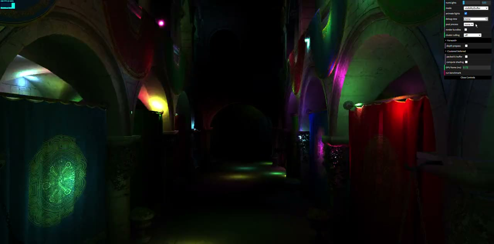
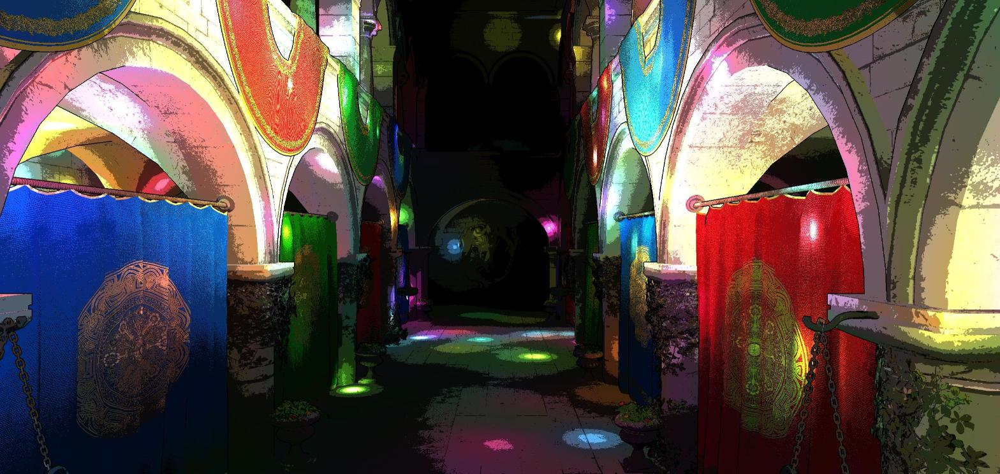
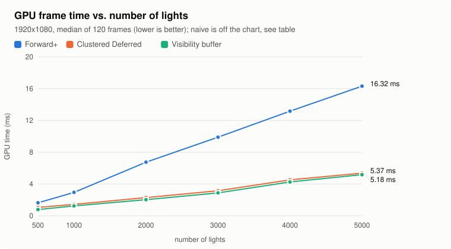
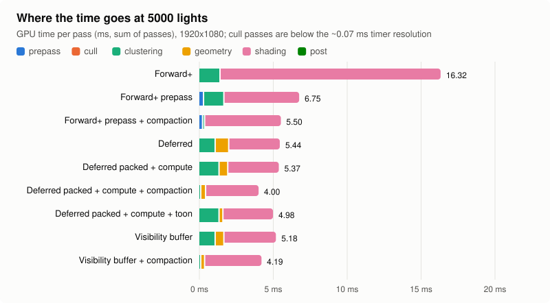
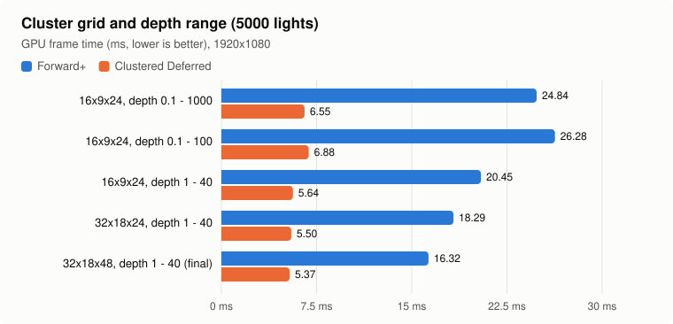
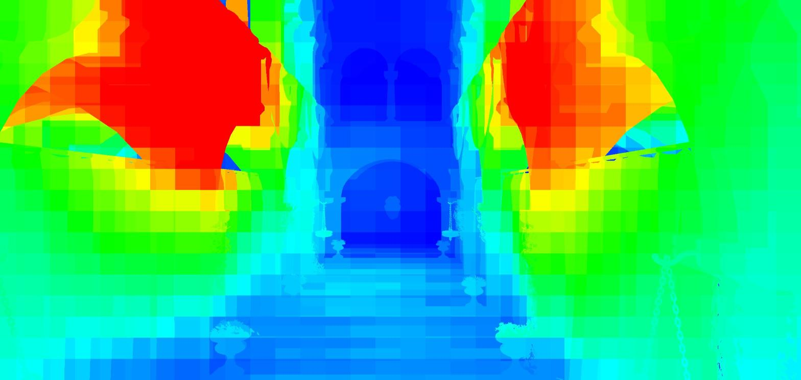
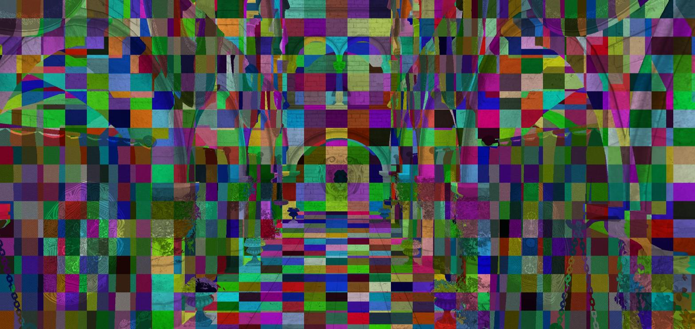
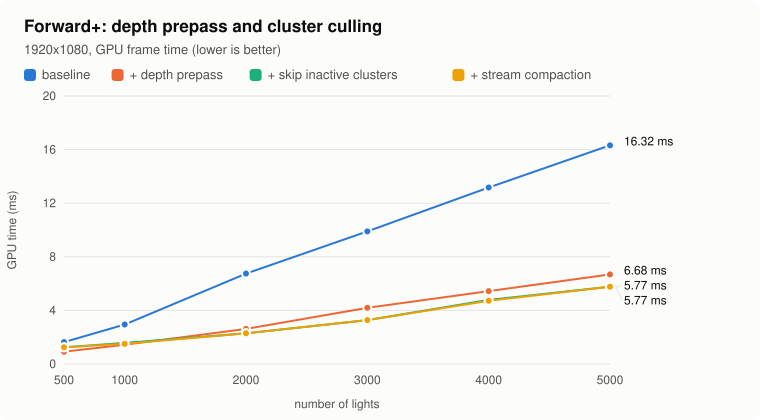
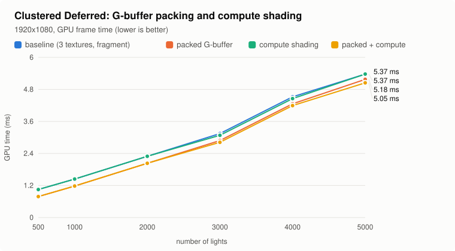
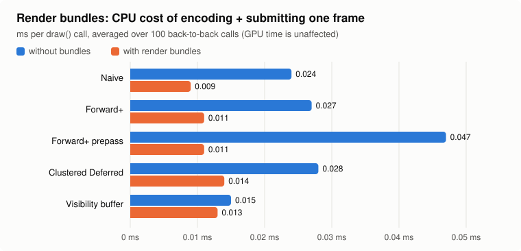

WebGPU Forward+ and Clustered Deferred Shading
======================

**University of Pennsylvania, CIS 565: GPU Programming and Architecture, Project 4**

* Weike Qian
* Tested on: **Google Chrome 155** on Windows 11, i9-13980HX @ 2.20GHz 32GB, NVIDIA GeForce RTX 4080 Laptop GPU (driver 32.0.16.1714)

### Live Demo

**https://rev3nus.github.io/CIS-5650-Project4/** (needs a WebGPU browser; Chrome works best)

### Demo Video/GIF

[`img/demo.mp4`](img/demo.mp4) (43 s): render modes, debug views, toon shading and the optimization toggles.

---

## Overview

Sponza with up to 5000 moving point lights (radius 2), rendered four ways:

| Mode | Idea |
|---|---|
| Naive | every fragment loops over every light |
| Forward+ | a compute pass bins lights into a 3D grid of frustum clusters; fragments only loop over their cluster's lights |
| Clustered Deferred | same clusters, but geometry goes to a G-buffer first and lighting runs once per pixel |
| Visibility buffer | the geometry pass writes only `(objectId << 16) \| triangleId`; a compute pass rebuilds the rest and shades |

At 5000 lights and 1080p: naive 289 ms, Forward+ 16.3 ms, Clustered Deferred 5.4 ms, best variants 4.3 ms (GPU time per frame).

### Features

| Feature | Files | GUI |
|---|---|---|
| Naive renderer | `naive.ts`, `camera.ts` | mode |
| Light clustering (workgroup per cluster, compact light lists) | `clustering.cs.wgsl`, `lights.ts` | - |
| Forward+ | `forward_plus.ts`, `forward_plus.fs.wgsl` | mode |
| Clustered Deferred | `clustered_deferred.ts` | mode |
| Extra: toon shading post-process (compute) | `postprocess.ts`, `toon.cs.wgsl` | post process |
| Extra: compute shading pass instead of fullscreen pass | `clustered_deferred_shading.cs.wgsl` | Clustered Deferred → compute shading |
| Extra: packed G-buffer (one `rg32uint`) | `clustered_deferred_packed.fs.wgsl`, `gbuffer_packed.wgsl` | Clustered Deferred → packed G-buffer |
| Extra: visibility buffer | `visibility_buffer.ts`, `visibility*.wgsl` | mode |
| Extra: render bundles | `renderer.ts` | render bundles |
| Extra: Forward+ depth prepass | `forward_plus.ts`, `depth_prepass.fs.wgsl` | Forward+ → depth prepass |
| Extra: depth-based cluster culling (skip inactive / stream compaction) | `cluster_culling.ts`, `cluster_culling.cs.wgsl` | cluster culling |
| Debug views: lights per cluster, cluster ids | `clustered_shading.wgsl` | debug view |
| GPU timestamp profiler, benchmark | `profiler.ts`, `main.ts` | GPU frame (ms), run benchmark |

Cluster culling works for deferred and the visibility buffer as is; Forward+ needs the depth prepass for it.

### Controls

* WASD / Q / E to move, drag to look, Shift / Alt to go faster / slower.
* **animate lights** freezes the lights, **debug view** shows the cluster visualizations.
* `?resolution=1920x1080` renders at a fixed resolution. All numbers below use it.
* **run benchmark** (or `runBenchmark()` / `runCpuBenchmark()` in the console) runs every configuration and prints a table.

---

## Implementation

### Clusters

The frustum is split into 32 x 18 x 48 clusters: 32 x 18 screen tiles and 48 exponential depth slices
(slice *k* starts at `near * (far / near)^(k / 48)`), so clusters are roughly cube-shaped at every depth.

* **Light assignment** (`clustering.cs.wgsl`): the tile corners are unprojected onto the near plane and scaled along the eye
  rays to the slice's near and far depth, giving a view-space AABB. A light is added if its sphere intersects that AABB. The AABB
  contains the cluster, so no light that reaches the cluster is missed, and since `rangeAttenuation` is 0 past the radius the result
  matches looping over all lights.
* **Lookup** (`clustered_shading.wgsl`): pixel position gives the tile, `log(depth / near) / log(far / near) * 48` gives the slice.
* **Depth range.** The camera uses near 0.1 / far 1000, but Sponza is only ~30 units long. Slicing 0.1-1000 puts half the slices
  outside the scene, so the slices cover view depth 1-40 instead. The first and last slice extend to the camera planes, so nothing
  falls outside the grid.
* **One workgroup per cluster.** 64 threads split the light list, gather hits in workgroup memory, and reserve space in a
  shared pool with one atomic.
* **Compact light lists.** A cluster stores `{offset, count}` into one shared index pool (32 MB) instead of a fixed
  `array<u32, N>`. The fixed array overflowed next to clumps of lights and dropped them silently (see
  [below](#what-went-wrong)).

### Forward+

Clustering compute pass, then one geometry pass that shades each fragment with its cluster's lights.

### Clustered Deferred

Clustering, a G-buffer pass (albedo `rgba8unorm`, normal `rgba16float`, world position `rgba32float`), then a fullscreen
triangle that reads the G-buffer and shades.

### Extra credit

* **Toon post-process.** The lit image is rendered offscreen; a compute pass quantizes luminance into 5 bands (in sqrt space, so
  dark areas don't all collapse into one band) and draws outlines where view depth jumps more than 3% between neighbors.

  
* **Compute shading pass.** An 8x8 compute shader replaces the fullscreen pass and writes straight to the canvas, which is
  configured as `rgba8unorm` with `STORAGE_BINDING`.
* **Packed G-buffer.** One `rg32uint` target: `x = pack4x8unorm(albedo)`, `y` = octahedral normal (`pack2x16snorm`). World
  position is rebuilt from the `depth32float` depth buffer. Color targets go from 28 B to 8 B per pixel (36 B to 12 B with depth).
* **Visibility buffer.** All primitives are merged into one vertex and one index storage buffer, plus an object table
  (model matrix, offsets, material). The geometry pass uses non-indexed draws with vertex pulling: `vertex_index / 3` is the
  triangle id and `firstInstance` is the object id. The `r32uint` target stores `(objectId << 16) | triangleId` (Sponza has 103
  objects and at most 27 796 triangles per object). The shading pass fetches the triangle, rebuilds the position from depth,
  computes barycentrics, interpolates UV and normal, and samples a `texture_2d_array` holding all 25 diffuse textures (blitted to
  1024x1024 at startup).
* **Render bundles.** The scene draws of every geometry pass (including the prepass and visibility pass) can be recorded once into
  a `GPURenderBundle` and replayed each frame.
* **Depth prepass.** A depth-only pass (with alpha test), then the shading pass with `depthCompare: "equal"` and no depth writes,
  so each pixel is shaded once. The vertex position is `@invariant` so both passes write the same depth. Override constants turn
  off the alpha test in the shading pass and take the cluster slice from the depth buffer.
* **Depth-based cluster culling.** Once depth is available, a compute pass (one thread per pixel) marks every cluster that contains
  a visible surface. Then either:
  * **skip inactive**: same clustering dispatch, but unmarked clusters return immediately, or
  * **stream compaction**: marked clusters are appended to a list, which drives a `dispatchWorkgroupsIndirect` with one workgroup
    per active cluster.

  Pixels within 0.001 slices of a slice boundary also mark the neighboring slice, so rounding differences can't leave a shaded
  pixel in an unmarked cluster.

---

## Performance analysis

GPU time per pass comes from `timestamp-query`: median of 120 frames after 30 warm-up frames, 1920x1080, default camera, lights
frozen at the same time for every configuration. Chrome quantizes timestamps to ~0.066 ms, so very short passes read as 0 or
0.066.

### Naive vs. Forward+ vs. Clustered Deferred

| lights | Naive | Forward+ | Clustered Deferred | Visibility buffer |
|---:|---:|---:|---:|---:|
| 500 | 29.4 | 1.64 | 1.05 | 0.79 |
| 1000 | 58.9 | 2.95 | 1.44 | 1.25 |
| 2000 | 116.3 | 6.75 | 2.29 | 2.03 |
| 3000 | 173.3 | 9.90 | 3.15 | 2.88 |
| 4000 | 230.0 | 13.17 | 4.52 | 4.26 |
| 5000 | 289.1 | 16.32 | 5.37 | 5.18 |

*(GPU ms per frame.)*

* Both clustered renderers are over 10x faster than naive (18x Forward+, 54x deferred at 5000 lights): a fragment loops over the
  tens to hundreds of lights in its cluster instead of all 5000.
* Clustered Deferred is 1.6x-3x faster than Forward+, and the gap grows with the light count. The reason is overdraw: Forward+
  shades every fragment that passes the depth test when it is drawn, even if a later draw covers it, and Sponza's draw order is
  arbitrary. Deferred pays a fixed 0.5-0.9 ms for the G-buffer and then shades each pixel once.
* Forward+ is the better choice with cheap shading or little overdraw (few lights, sorted geometry, or a depth prepass, see below),
  and it keeps MSAA, transparency and per-material shading without G-buffer memory. Deferred wins with many lights and high depth
  complexity, at the cost of G-buffer bandwidth and memory (36 B per pixel here, 75 MB at 1080p), no hardware MSAA, no
  transparency and a single lighting model.

Shading dominates everywhere; clustering is at most ~1.4 ms and the geometry passes 0.3-0.9 ms.

### Cluster grid and depth range

* Limiting the slices to depth 1-40 instead of 0.1-1000 is the biggest single win: -18% Forward+, -14% deferred, with the same
  3456 clusters. Each slice inside the scene goes from 47% to 17% of its distance in thickness, so clusters overlap fewer lights.
  0.1-100 doesn't help, because the slices between 0.1 and 1 are still wasted.
* Finer grids keep helping (32x18x48: another -20% on Forward+) but make clustering more expensive (0.13 ms → 1.4 ms at 5000
  lights, 3456 → 27 648 clusters). Cluster culling removes most of that cost.
* The light radius sets a floor on the per-cluster light count: even a tiny cluster gets every light within 2 units. That's why
  walls stay red in the debug view.

**Lights per cluster** (blue = 0, red = 256+, 2000 lights). Shading cost per pixel is proportional to this. The red areas are the
upper galleries, where the lights are densest.

**Cluster ids** (random color per cluster). The exponential slices show up as bands on the floor that get longer with distance.

### Light clustering: thread vs. workgroup per cluster

My first version used one thread per cluster looping over all lights. With all 27 648 clusters that is enough work to fill the
GPU, so the pass took ~1.4 ms either way. With culling, though, only the clusters with visible geometry remain, and each of those
threads still loops over 5000 lights, so culling saved nothing (1.70 ms → 1.70 ms). With a 64-thread workgroup per cluster the loop is
64x shorter, and culling brings the pass down to 0.07-0.13 ms.

### Forward+: depth prepass and cluster culling

| 5000 lights | prepass | clustering | shading | frame |
|---|---:|---:|---:|---:|
| Forward+ | - | 1.44 | 14.88 | 16.32 |
| + depth prepass | 0.33 | 1.38 | 5.05 | 6.69 |
| + prepass + skip inactive | 0.26 | 0.13 | 5.11 | 5.77 |
| + prepass + stream compaction | 0.26 | 0.13 | 5.11 | 5.77 |

* **Depth prepass: 2.4x faster** (16.3 → 6.7 ms). Shading drops from 14.9 to 5.0 ms, so this view has ~3x overdraw. The cost is
  drawing the geometry twice (~0.3 ms). Best case: high depth complexity and expensive shading, as here. Worst case: no overdraw
  and cheap shading, where it is pure overhead. It brings Forward+ within ~25% of deferred without a G-buffer.
* **Cluster culling: another -14%** (6.69 → 5.77 ms). Clustering drops from 1.38 to 0.13 ms; the mark and compaction passes are
  below the timer resolution. Best case: fine grid, many lights. Worst case: few lights. At 500 lights the culled version is
  slower (0.92 → 1.25 ms) because there is little clustering to save and the shading pass gets ~0.4 ms slower. That slowdown
  shows up whenever the depth buffer is sampled before the "equal" pass; I suspect sampling it decompresses the depth buffer and
  the following depth test loses its compression / Hi-Z, but I haven't verified this.
* **Skip vs. compaction:** no difference here. An inactive workgroup exits after one flag read, which is almost free. Compaction
  should matter more with many more clusters or more per-cluster setup.

### Clustered Deferred: packed G-buffer and compute shading

| 1000 lights | G-buffer pass | shading | frame |
|---|---:|---:|---:|
| baseline (3 textures, fullscreen pass) | 0.52 | 0.66 | 1.44 |
| packed G-buffer | 0.26 | 0.66 | 1.18 |
| compute shading | 0.52 | 0.66 | 1.44 |
| packed + compute | 0.26 | 0.66 | 1.18 |
| packed + compute + cluster culling | 0.26 | 0.66 | 0.98 |

* **Packed G-buffer:** the G-buffer pass is 2x faster (0.52 → 0.26 ms, -18% frame) since it writes 8 B instead of 28 B per pixel.
  The shading pass reads less but decodes more (octahedral normal, position from depth), which roughly cancels out on this GPU.
  It should help more on bandwidth-limited GPUs or at higher resolutions. The cost is precision (8-bit albedo, 16-bit normals) and
  no room for more material data.
* **Compute shading:** no measurable difference. The fullscreen triangle is already cheap; the compute version would mainly be
  useful for sharing per-tile data in workgroup memory.
* **Cluster culling** also helps deferred: -0.2 ms at 1000 lights, -0.8 ms (-16%) at 5000.

### Visibility buffer

4 B per pixel (+ 4 B depth); the geometry pass costs the same as the packed G-buffer (0.26 ms). The shading pass also matches the
packed G-buffer (3.47 ms at 5000 lights) even though every pixel fetches 3 vertices and computes barycentrics. Overall it ties
with packed deferred (5.18 ms, 4.26 ms with culling). Its advantage is bandwidth, which this GPU has plenty of, so it should do
better on bandwidth-limited hardware, at higher resolutions, or with heavier materials. Possible improvements: barycentrics from a
ray-triangle intersection instead of the reconstructed position (see Correctness), mip selection from analytic derivatives.

### Render bundles

CPU time of `draw()`, averaged over 100 back-to-back calls (one frame is below the 0.1 ms resolution of `performance.now()`).
Bundles cut it by 2-4x (Forward+ with prepass: 0.047 → 0.011 ms); GPU time doesn't change. The visibility buffer barely benefits
since it has no per-draw bind group changes. With ~100 draws the CPU was never the bottleneck; bundles matter with thousands of
draws. The downside is that bundles are static, so per-frame culling or LOD would require re-recording.

## Correctness

Every configuration is diffed against the naive renderer (all 5000 lights, frozen):

| configuration | pixels differing by > 4/255 |
|---|---:|
| Forward+ | 0 (max difference 1/255) |
| Forward+ + depth prepass (any culling mode) | 0.014% |
| Clustered Deferred (all four G-buffer / shading combinations, any culling mode) | 0.09-0.10% |
| Visibility buffer (any culling mode) | 1.1% |

The prepass uses `depth32float` instead of `depth24plus`, which resolves a few coplanar surfaces differently. Deferred differs
because of 16-bit normals and reconstructed positions. The visibility buffer differences are on the banners and curtains: their
texture is high-frequency, and the UV from the reconstructed position is slightly off, so a neighboring texel gets picked.

### Credits

- [Vite](https://vitejs.dev/)
- [loaders.gl](https://loaders.gl/)
- [dat.GUI](https://github.com/dataarts/dat.gui)
- [stats.js](https://github.com/mrdoob/stats.js)
- [wgpu-matrix](https://github.com/greggman/wgpu-matrix)
- Octahedral normal encoding: Cigolle et al., "A Survey of Efficient Representations for Independent Unit Vectors" (JCGT 2014).
